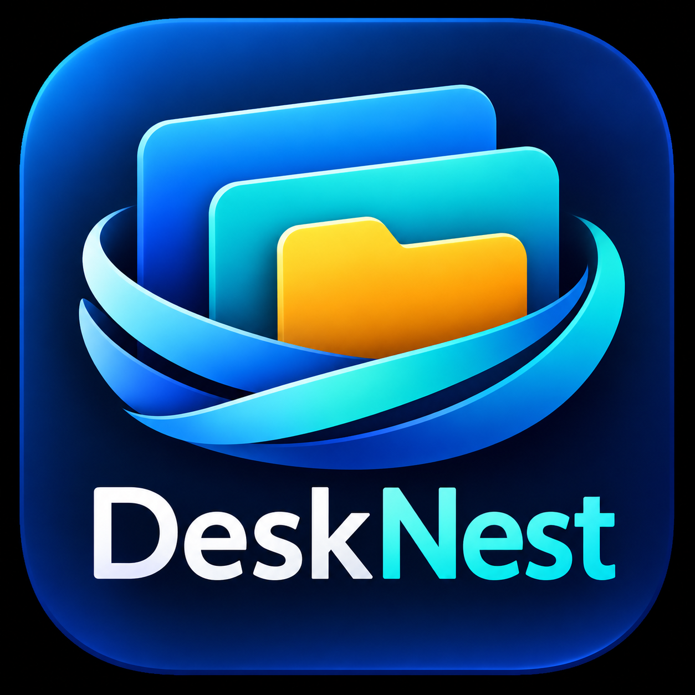

# DeskNest

[](https://github.com/aziizfarhat/DeskNest/actions/workflows/ci.yml)



**Organize your Windows desktop with customizable zones and folder portals.**

DeskNest is a lightweight Windows desktop organizer that helps you group applications, shortcuts, files, and folders into customizable desktop areas called *Nests*.

Instead of leaving everything scattered across your desktop, DeskNest provides a more organized and accessible workspace.

> **Project status:** Under active development. DeskNest is currently at version 0.8.3.4.

## Features

### Desktop Zones (Nests)

Create independent desktop areas to organize your items by category, purpose, or workflow.

- Create and rename zones.
- Select all items within a zone.
- Customize background colors and opacity.
- Choose a per-zone background: solid colour, gradient, image, or acrylic (blurred wallpaper).
- Preview images, videos, and PDF files with thumbnails instead of generic icons.
- Open items with a single click or a double-click (option in Settings › Behavior).
- Adjust icon size and fonts.
- Hide zone titles.
- Roll up zones to save desktop space.
- Lock zones.
- Expand zones automatically when hovering over them.
- Search the items of a zone from an optional search bar.
- Link zones to folders.
- Delete zones.
- Undo and redo layout changes with `Ctrl+Z` / `Ctrl+Y`.
- Snap zones to each other and to the screen edges, with alignment guides.
- Distribute zones evenly across the screen.
- Duplicate a zone or save it as a reusable template (color, size, fonts, and view mode).
- Apply a saved template to an existing zone from the zone menu or the Settings › Templates tab.
- Move items between the desktop and a zone and undo the move with `Ctrl+Z`; the item returns to its original zone or desktop position.

### Folder Portals

Folder Portals provide convenient access to folder contents directly from your desktop.

- Create Folder Portals.
- Link zones to existing folders.
- Keep frequently used files and folders organized and accessible.

### Global Search

Press `Ctrl+Shift+Space` to open the search palette and search every zone, folder portal, and the desktop at once. Selecting a result reveals the item in its zone or opens it directly. The palette takes keyboard focus as soon as it opens, so typing never reaches the desktop or another application. Press `Escape` or click outside the palette to close it.

### Windows Integration

DeskNest integrates with the Windows desktop environment.

- Dedicated context menu for desktop zones.
- Desktop background context menu for creating new zones and Folder Portals.
- Windows startup option.
- Configurable global hotkeys for toggling zones and opening the search palette (Settings › Shortcuts).
- Single-instance application support.
- Stays visible when using the Windows “Show desktop” command.
- Native Windows desktop integration.
- Automatic update checks against GitHub releases, with SHA-256 verification and an optional silent installation.
- Restore all items to the desktop from the tray menu.
- Recovery of items left in the managed store after a crash.
- Optional Authenticode code-signing for release builds.

The desktop background context menu is available while DeskNest is running and is removed when the application exits normally.
The desktop background context menu uses DeskNest's localization system.

### Multilingual Interface

DeskNest includes translations for twelve languages:

- English
- French
- Italian
- German
- Spanish
- Portuguese
- Arabic
- Simplified Chinese
- Japanese
- Korean
- Russian
- Ukrainian

## Screenshots

Screenshots will be added as the project documentation evolves.

## System Requirements

- Windows 10 or Windows 11
- 64-bit Windows

The standalone application is published as a self-contained executable, so the .NET Desktop Runtime is not required to run that build.

## Installation

DeskNest is distributed through an Inno Setup installer.

The installer provides:

- Installation without requiring administrator privileges.
- Optional automatic startup with Windows.
- A standard Windows uninstall entry.
- A shortcut in the Start Menu.
- The GPL-3.0 license text.
- An uninstall prompt that keeps zones, settings and backups by default, with an option to delete them.

The installer interface is available in the same twelve languages as DeskNest. Simplified Chinese uses the translation vendored in `installer-lang/` because Inno Setup does not ship it.

### Building the Installer

To build the installer:

1. Build and publish the application.
2. Make sure `publish\DeskNest.exe` exists.
3. Open `installer.iss` with Inno Setup.
4. Compile the installer.

The resulting installer is generated in the `installer` directory.

## Building from Source

### Requirements

- Windows 10 or Windows 11 (64-bit)
- [.NET 8 SDK](https://dotnet.microsoft.com/download/dotnet/8.0)
- Git

### Clone the Repository

```powershell
git clone https://github.com/aziizfarhat/DeskNest.git
cd DeskNest
```

### Build and Run

```powershell
dotnet restore
dotnet build
dotnet run
```

### Run the Tests

```powershell
dotnet run --project DeskNest.Tests\DeskNest.Tests.csproj -c Release
```

The test project uses an in-memory file system, so it never reads or writes `%APPDATA%\DeskNest`.

### Create a Standalone Release

DeskNest includes a build script that automates the publishing and installer creation process.

Simply run:

```powershell
.\build.bat
```

The script automatically:

1. Reads the application version from `DeskNest.csproj`.
2. Publishes a self-contained, single-file Windows x64 executable.
3. Applies ReadyToRun compilation and removes debug symbols.
4. Signs the application with `signtool` when a certificate is configured.
5. Creates the portable ZIP archive.
6. Detects Inno Setup 6, if installed, and creates the Windows installer.
7. Signs the installer when a certificate is configured.

**Generated files:**

| Output | Description |
|---|---|
| `publish/DeskNest.exe` | Portable standalone executable |
| `publish/DeskNest-<version>-Portable.zip` | Portable archive containing `DeskNest.exe` and `LICENSE` |
| `installer/DeskNest-Setup-<version>.exe` | Windows installer (when Inno Setup 6 is available) |
| `installer/DeskNest-Setup-<version>.exe.sha256` | SHA-256 checksum used by automatic updates |

For example, with version `0.8.3.3` the script produces `publish/DeskNest-0.8.3.3-Portable.zip`, `installer/DeskNest-Setup-0.8.3.3.exe` and its `.sha256` checksum.

The target computer does not need the .NET Desktop Runtime to run the standalone release.

### Code Signing

Release builds can be signed with an Authenticode certificate. Set the following environment variables before running `build.bat`:

| Variable | Description |
|---|---|
| `DESKNEST_PFX` | Path to the `.pfx` code-signing certificate |
| `DESKNEST_PFX_PASSWORD` | Password of the certificate (optional) |

When `DESKNEST_PFX` is not set, the build succeeds but remains unsigned. Automatic updates are verified with the SHA-256 checksum published with the release; if a certificate is configured, the installer is also signed and its Authenticode signature can be checked.

## Technology

DeskNest is built using:

- C#
- .NET 8
- Windows Presentation Foundation (WPF)
- Windows Forms
- Windows Registry integration
- Windows APIs
- Named Pipes for inter-process communication

Neither the application nor the test project declares external NuGet package dependencies.

## Project Structure

Some of the main source files:

| File | Purpose |
|---|---|
| `App.xaml.cs` | Application startup and lifecycle |
| `Views/NestWindow.xaml` | Zone interface |
| `Views/SettingsWindow.xaml` | Application settings |
| `Views/SearchPalette.xaml` | Global search palette |
| `Views/GuideOverlay.cs` | Alignment guide overlay |
| `Views/TrayIcon.cs` | System tray integration |
| `Views/DesktopContextMenu.cs` | Desktop background context menu |
| `Services/NestManager*.cs` | Zone management, split by concern |
| `Services/Storage.cs` | Layout persistence and backups |
| `Services/IFileSystem.cs` | File-system abstraction used by the tests |
| `Services/UpdateChecker.cs` | GitHub release checks and installer verification |
| `Services/DesktopHelper.cs` | Windows desktop integration |
| `Services/DesktopStore.cs` | Desktop item management |
| `Services/DesktopWatcher.cs` | Desktop monitoring |
| `Services/CommandServer.cs` | Inter-process command handling |
| `Services/SnapEngine.cs` | Snapping and alignment calculations |
| `Services/Loc.cs` | Localization |
| `Models/Models.cs` | Data models |
| `Models/Undo.cs` | Undo and redo history |
| `Native/GlobalHotkey.cs` | Global hotkey registration |
| `DeskNest.Tests/` | Automated tests |
| `installer.iss` | Windows installer configuration |
| `CHANGELOG.md` | Release history |

## Contributing

Contributions, suggestions, and bug reports are welcome.

Before submitting changes:

1. Build the project using `dotnet build`.
2. Run the tests using `dotnet run --project DeskNest.Tests\DeskNest.Tests.csproj -c Release`.
3. Test the modified functionality on Windows.
4. Provide clear reproduction steps for bug reports.

For substantial changes, please open an issue first to discuss the proposed implementation.

## Bug Reports and Feature Requests

Please use the [GitHub Issues](https://github.com/aziizfarhat/DeskNest/issues) page to report bugs or suggest improvements.

## License

DeskNest is released under the [GNU General Public License v3.0](https://www.gnu.org/licenses/gpl-3.0.html) (GPL-3.0).

You may use, study, share and modify the software under the terms of the GPL-3.0. If you distribute modified versions, you must release them under the same license and make the corresponding source code available. The software is provided without warranty.

See [LICENSE](LICENSE) for the full legal text.
